# MEME STAGE

> 把二十个人塞进一张画布，然后让他们开口。
> An infinite meme canvas where every character has a voice, a line, and an opinion.

[**▶ 打开线上版本**](https://meme-stage.pages.dev) · [**🎭 先玩官方示例**](https://meme-stage.pages.dev/p/demo) · [**𝕏 @0xkillcoin**](https://x.com/0xkillcoin)


---

## 这是什么

**MEME STAGE** 不是图片编辑器，也不是在线白板。

它把「贴纸拼贴」和「语音互动」揉在一起：一次导入几十个人物，给每个人绑多条独立语音（**导入真实音频，或直接输入文字生成语音**），编排「点谁 → 谁说话 → 谁接梗」的互动链，最后发布成一个**打开就能点、点了就有声音**的网页作品。

- 不需要注册，不需要写代码。
- 桌面端负责创作，手机端负责浏览和玩。
- 发布后就是一个链接，丢进 X、微信群、Telegram 都能打开。

官方示例（真实发布）：**https://meme-stage.pages.dev/p/demo**

---

## 截图

| 首页 · 可直接点人物试听 | 创作工作台 · 50 人物 |
| --- | --- |
| 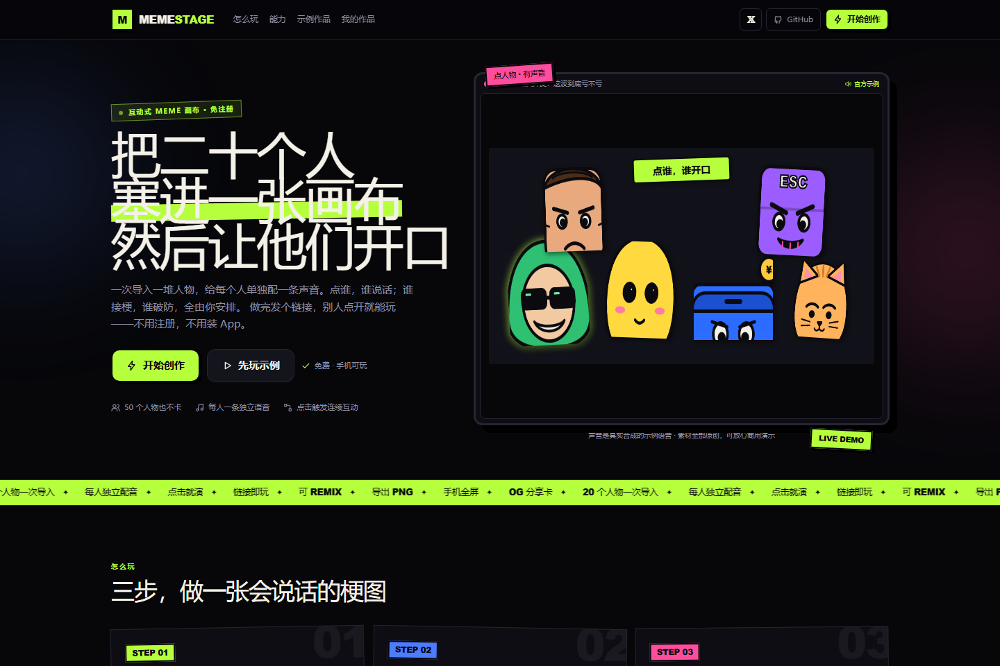 | 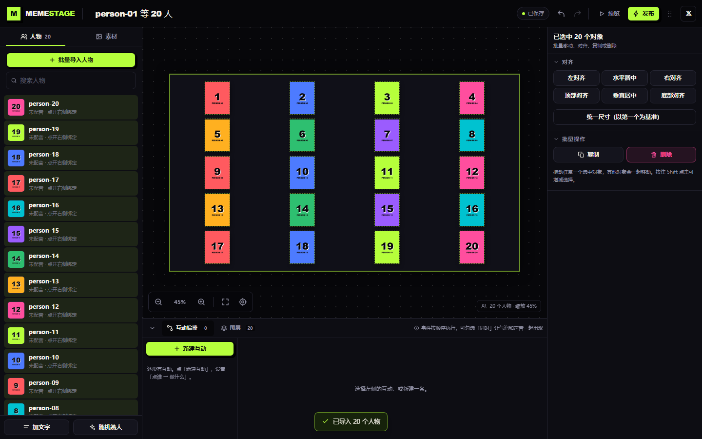 |

| 批量导入 · 自动布局 | 发布后的访客页面 |
| --- | --- |
| 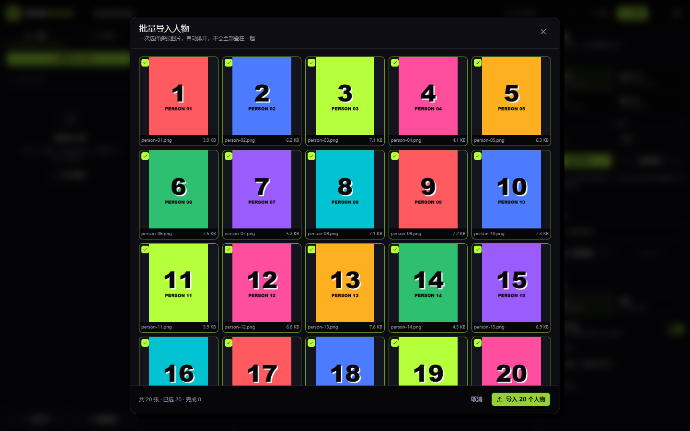 | 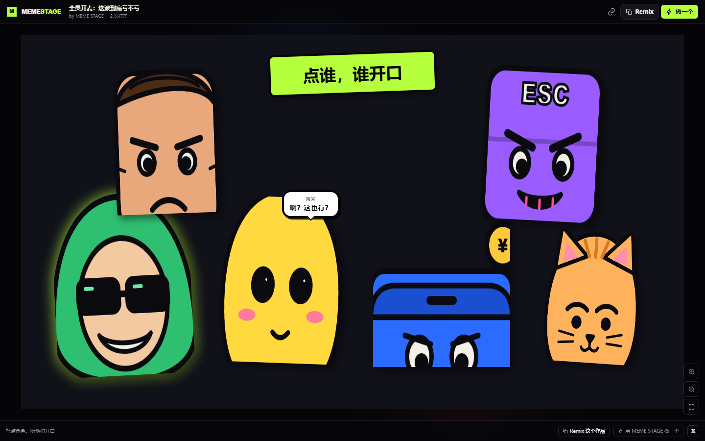 |

| 多语音人物 · 每段独立台词与音量 | 气泡位置 · 预览里直接拖 |
| --- | --- |
| 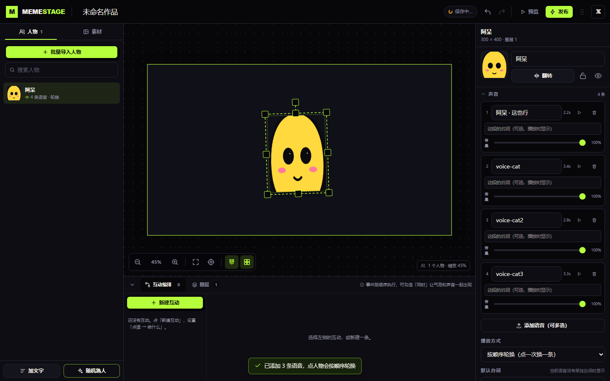 | 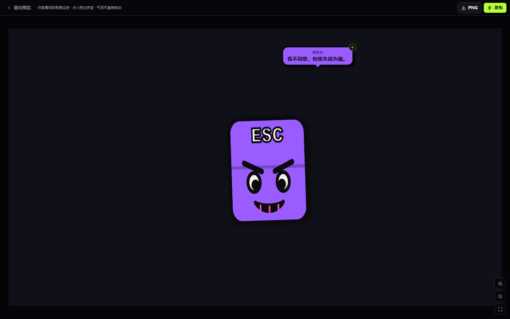 |

| 文字生成语音 · 选语言和语速 | 浏览器自带朗读 · 免 key |
| --- | --- |
| 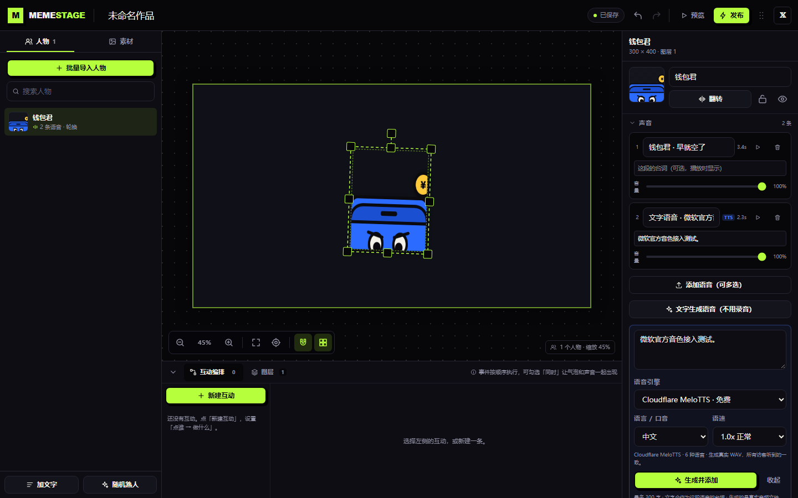 | 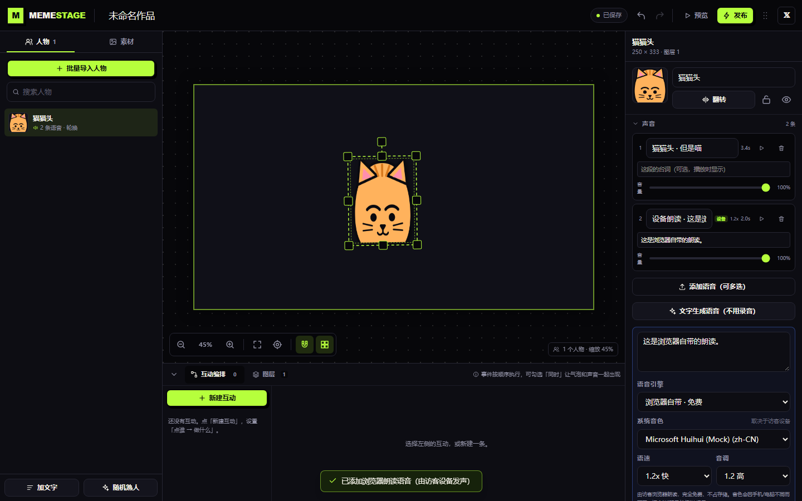 |

| 录音 · 波形裁剪 |
| --- |
| 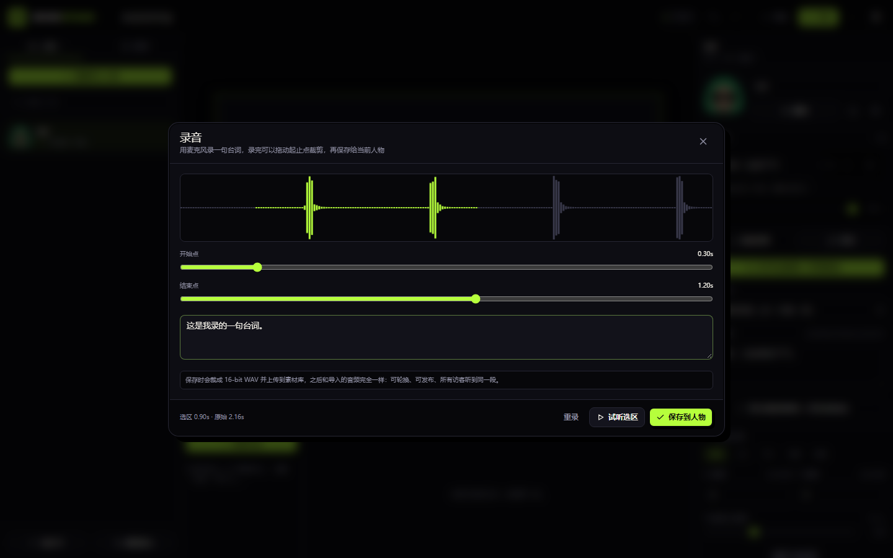 |

| 剧本时间线 · 一行一句 | 三人小品演出 |
| --- | --- |
| 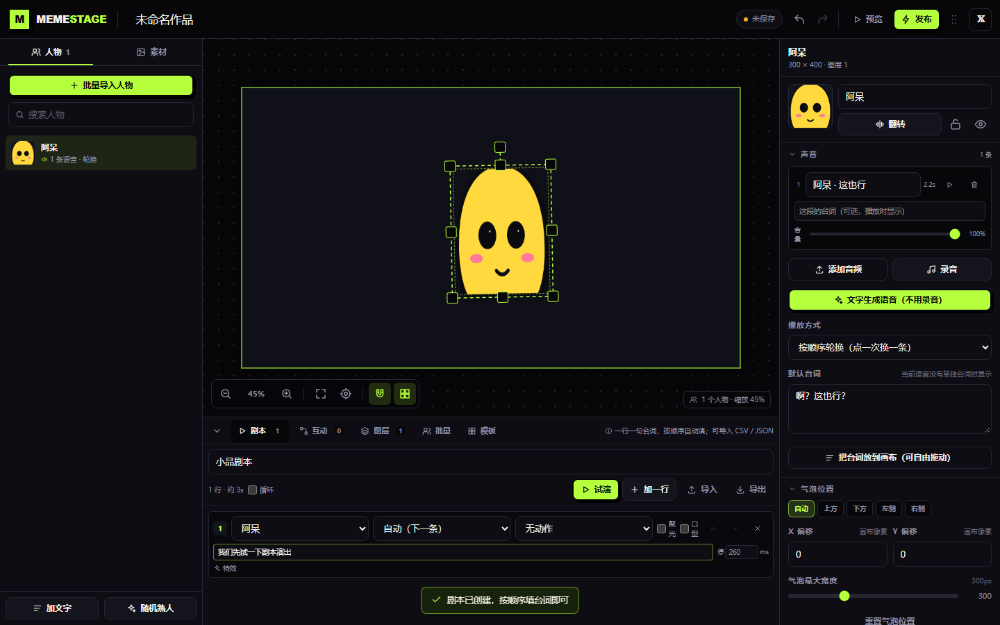 | 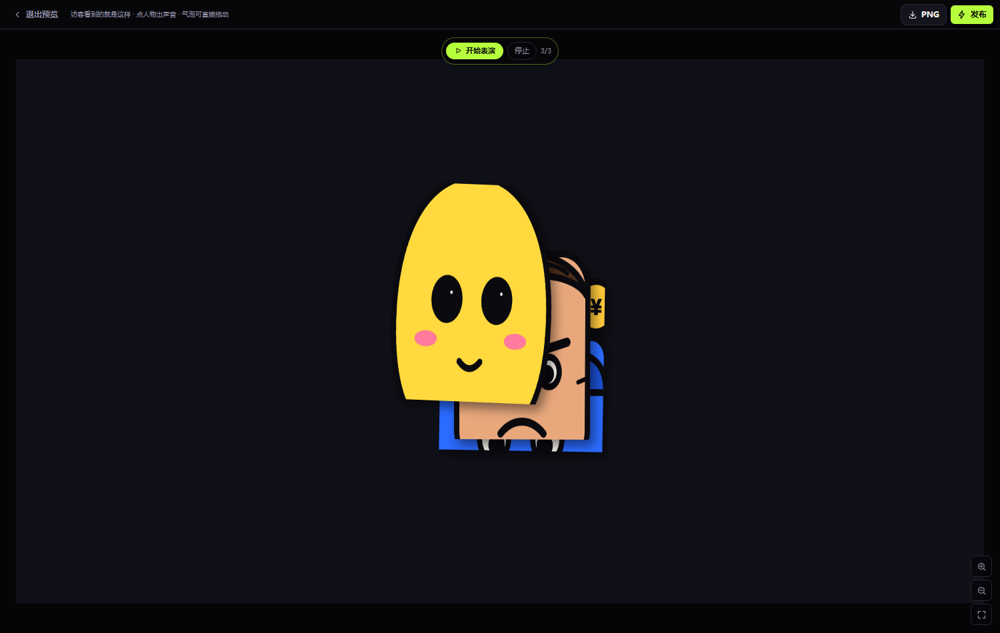 |

| 批量工作台 · 表格化编辑 | 舞台模板 |
| --- | --- |
| 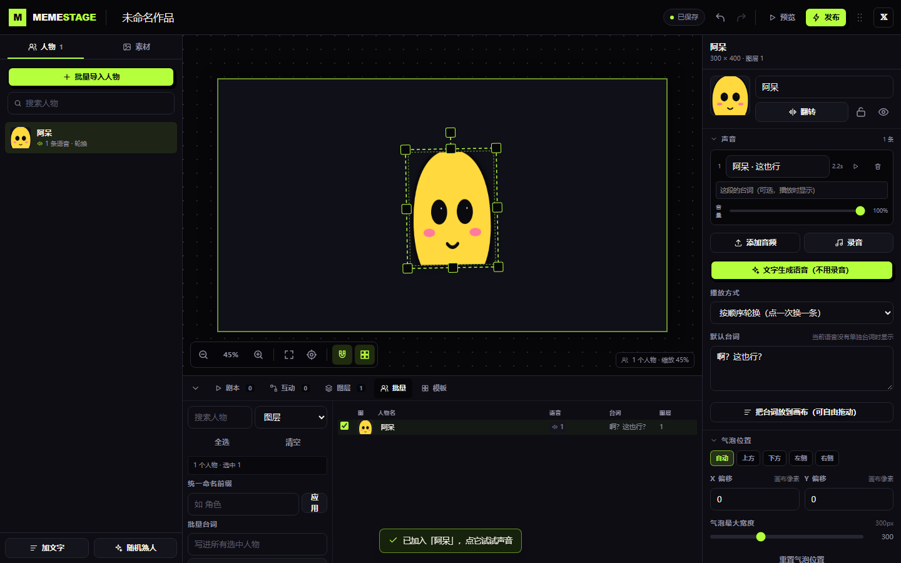 | 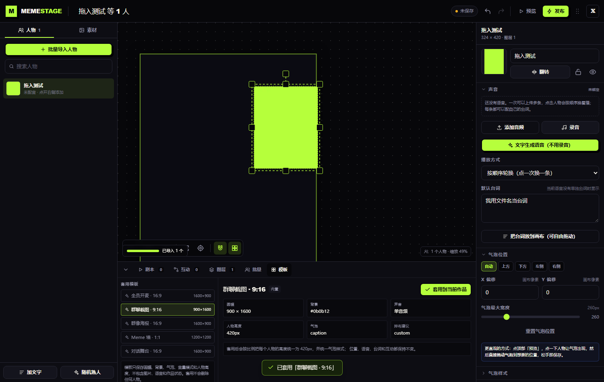 |
| 手机端作品页 | 手机端编辑器 |
| --- | --- |
| 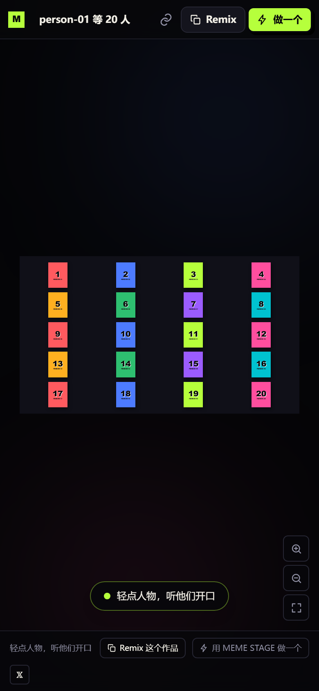 | 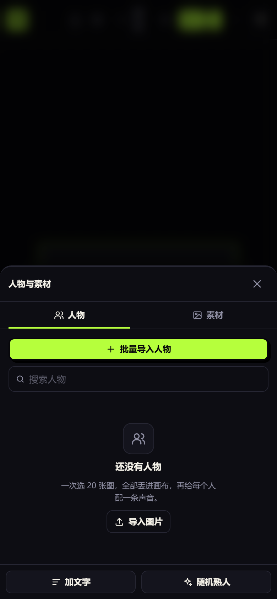 |

---

## 已实现的功能

### 贴纸工坊（本地抠图）

- **完全在本机**：人物分割、人脸/468 点 FaceMesh、Alpha Mask、描边全部跑在浏览器里，原图和蒙版不上传。
- **7 种裁切**：只要脸 / 头部 / 头+脖子 / 头+肩 / 上半身 / 去背 / 整个人。
- **程序化描边**：单层或双层（默认白粗边 + 黑细外线），颜色、粗细、羽化、扩张/收缩都可调；改描边不会重新跑模型。
- **手动 Mask 修复**：擦除 / 恢复画笔、笔刷大小与硬度、平滑、还原；源图永不被改写。
- **多主体**：一张合照里检测出多张脸时可以选主体，人脸只用来定位，最终轮廓始终来自真实 Alpha。
- **保存与导出**：结果存进本机 IndexedDB（IndexedDB 不可用时明确报错），可下载透明 PNG，也可一键作为**独立图层**或**角色**加入 MEME STAGE 画布。
- **诚实的状态**：颜色蒙版 fallback、蒙版为空、模型加载失败都会显示具体原因，不会把 fallback 当作成功。

### 批量工坊

- **同一套引擎**：批量调用的是和单张完全相同的 processor，不存在第二份抠图代码。
- **可恢复队列**：每个任务的阶段和结果写进 IndexedDB，刷新页面会恢复上一批任务；崩溃时正在处理的那张会标成 `interrupted` 并可重试。
- **真实进度**：阶段只会按 decoding → detecting → matting → composing → saving 推进，不显示假百分比。
- **失败隔离**：一张失败只影响自己，可单独重试；单张有 2 分钟超时保护，避免一张卡死拖住整队。
- **参数快照**：提交时把裁切模式、描边、输出尺寸写进这一批任务，之后改面板不影响已提交项。
- **导出**：成功项打包成 ZIP（含 `manifest.json`，失败项另附 `failed.json`），同名文件自动加序号，保留真实透明通道。
- **加入画布**：多张结果一次导入 Stage，每张都是独立图层，不会合成一张带背景的图片。

### STICKER（独立的贴纸生产入口）

顶栏菜单里的 **STICKER** 是一个独立功能（`/sticker`），不在编辑器里面套着一层 tab：

- **一条直线流程**：拖入 / 粘贴 / 点选一张图 → 导入后**立即自动跑本地识别** → 出结果 → 「存入素材库」，落在 MEME STAGE 的 `/assets` 里，并从库里高亮出来。
- **两个子页面**：`/sticker` 单张制作、`/sticker/batch` 批量制作（共用同一套抠图/描边引擎，没有第二份实现）。
- **本地优先**：分割、抠图、描边、颜色处理全部在浏览器里完成，不上传原图、不排队、不产生费用。
- **人物颜色**：原图彩色（默认）/ 灰度 / 黑白 / 双色调 / 漫画网点 / 自定义染色。切换只重跑合成，不重新识别。
- **描边预设**：无 / 细 / 中 / 粗 / 超粗 / 白粗+黑细（默认）。只改覆盖层参数，不动人物本体。
- **剪贴板导入**：截图工具里复制后直接 `Ctrl/Cmd + V`。
- **自动识别的理由**：既然产品承诺「导入即得贴纸」，导入后不该再让用户找一次「开始处理」按钮。
- **AI 是可选项**：默认完全不用生成式 AI；想风格化时用自己填的密钥（见下一节），失败不影响已抠好的图。

### AI 生图与风格化（自带密钥，服务端不持钥）

- **没有任何服务端密钥**：仓库、构建产物、Cloudflare secret 里都没有图像服务密钥。`/api/ai/*` 已整体删除，站主不为任何访客的生成付费。
- **密钥只存在使用者自己的浏览器**：在工坊右侧「我的 AI 密钥」粘贴、点「验证并保存」，密钥写入该浏览器的 `localStorage`，可随时「删除」。请求由浏览器直连图像服务（`Authorization` 头），不经过本站 Worker、不写数据库、不进日志。
- **真实校验**：保存时调用 `/v1/models` 验证，只列出这个密钥确实能用的模型（当前实测 17 个）；密钥失效 / 限流 / 断网会分别提示，不会被当成「功能不存在」。
- **文字生成贴纸**：题材预设 + 自定义提示词 + 模型选择，结果**从浏览器直接下载成字节**，再「保存到本机素材」（`kind: ai-generate`），之后可本地抠图加描边。
- **风格化已有贴纸**：5 种风格预设，当前贴纸以 `data:` URL 内联成参考图重绘（无需先上传），结果另存为新版本（`kind: ai-style`），原图与本地抠图都不被覆盖。
- **成本与失败都直说**：面板显示真实 token 用量并注明「费用由你的账号承担」，失败返回具体错误码，不拿占位图冒充成功。
- **透明背景默认关闭**：实测该网关在 `background:"transparent"` 下会稳定 196s 上游超时，同一提示词不加这个字段 15s 出图。开启时文字生图会自动去掉该参数重试一次（**复用同一幂等键**，不会重复计费）。
- **风格化从不重试**：重试若丢掉 `images` 会返回一张与用户贴纸无关的图，却仍被当成风格版，所以宁可让用户看到明确失败。
- **发布仍走同源素材**：生成的图片在加入作品时经 `/api/assets` 上传，与其他素材共用 8MB 上限和 600 条配额，发布页访问的始终是 `/api/files/:id`，不依赖会过期的 CDN 链接。
- **CSP 只放行必要来源**：`connect-src` / `img-src` 额外允许 `agent3.shyfai.cn` 与 `*.fycsai.com`，其余仍是 `'self'`。

### 剧本演出（小品模式）

- **一键演出**：三四个角色排好台词，点「开始表演」就按顺序自动说话；支持暂停 / 继续 / 停止 / 循环。暂停会就地挂起当前语音（不回到句首），继续时从原来的位置接着放。
- **底部剧本时间线**：每行可选人物、语音、台词、动作、停顿、聚光、口型；行可上下移动、删除；播放时当前行高亮，能看到正在说哪一句。
- **动作库扩充**：弹跳、抖动、弹出、旋转、呼吸、点头、转身、跳起、拉近、拉远、高亮、惊讶反应。
- **聚光**：说话的人保持原亮度，其他人自动变暗，舞台感更强。
- **口型开合**：说话时在人物嘴部叠一个两帧动画。每张图可以点一下照片直接标嘴的位置（人物面板里的「口型位置」），旋转和左右翻转都会跟着走；没标过的图按长宽比自动估一个位置。
- **特效贴纸**：每行可挂 GIF / WebP / MP4，按位置（头顶 / 脚下 / 左右 / 四角）、大小、时长播放，MP4 静音自动播放。
- **动图元素**：素材面板可上传 GIF / 动图 WebP / 短 MP4，作为独立元素放到画布；编辑器显示首帧，访客页用 DOM 层真实播放动画，支持旋转、翻转、透明度和聚光变暗。
- **剧本导入导出**：CSV（`order,actor,line,audio,action,waitAfter,spotlight`）或 JSON，按人物名匹配、按音频名匹配；也能导出成 CSV 再改。
- 访客页在有剧本时显示「开始表演」按钮，可在作品设置里关闭。

### 批量工作台

- **拖入即导入**：把图片拖到画布上，或直接 `Ctrl/Cmd + V` 粘贴，立即出现在画布并后台并发上传（并发 3）。
- **文件名即内容**：`猫猫头--我听不懂但是喵.png` 会自动得到人物名和台词；`老K-01.wav` / `老K--台词--02.wav` 按同名自动绑定到人物。
- **底部批量面板**：表格列出所有人物的名称、语音数、台词、图层，可直接改名、搜索、按图层/名字/语音排序。
- **批量操作**：统一命名前缀、批量写台词、统一气泡预设、统一音量、统一高度、按 6 种布局重新排布。
- **人物清单导入**：CSV / JSON 按名字匹配已有角色，只更新写到的字段（`name,line,voicemode,bubble,volume,height`），不新增也不删除人物；未匹配的名字会单独提示。
- **互动配方**：点谁谁说话 / 按顺序开麦 / 随机点名接梗 / 三轮对话 / 全员同时开口，一键生成事件。
- **模板**：内置「全员开麦 / 群聊截图 / 群像海报 / Meme 墙 / 对话舞台」5 个舞台，也可把当前画布存成模板；套用会改画幅、背景、气泡、音量模式，并按模板自己的排布方式把人重新摆到新画布上（保持图片、语音和互动不变）。

### 无限画布

- 平移（拖空白 / 空格拖 / 中键拖）、滚轮与触控板缩放、双指捏合缩放。
- 单击选择、Shift 多选、框选、多选整体拖动。
- 拖拽移动、8 向缩放、旋转、精确数值输入、透明度、翻转、锁定、隐藏。
- 吸附对齐 + 实时参考线（可关闭），Alt 临时关闭吸附。
- 图层面板、置顶 / 置底 / 上移 / 下移，稳定 ID 与连续 z 序。
- 撤销 / 重做（60 步，拖拽和滑杆会合并历史，不会产生几百条碎片记录）。
- 快捷键：`⌘/Ctrl+Z`、`⇧⌘Z`、`⌘D`、`⌘C/V`、方向键微调、`⌘0` 适应画布、`Delete`、`Esc`。
- 一键适应内容、一键定位选中、缩放比例显示、世界坐标与屏幕缩放在数据层完全分离。
- 画幅预设 16:9 / 9:16 / 1:1 / 4:5 + 自定义宽高 + 自由画布模式。

### 多人物批量导入

- 多选文件、拖拽文件、逐张追加，一次最多 300 个元素。
- 导入前在浏览器内压缩（长边 1500px WebP + 420px 缩略图），原图比例不变。
- 批量面板显示缩略图、文件名、实际尺寸、文件大小、上传状态与失败原因，可单张移除、全选/取消。
- 6 种自动布局：自由散落、网格、中心聚集、随机拼贴、避免重叠、自定义（列数 / 间距 / 人物高度 / 重叠度），带实时布局预览。
- 20 张图导入后 20 个坐标互不重复，且全部落在画幅内；50 张图实测同样通过（50 元素 / 50 唯一坐标 / 全部在画幅内）。导入后每个实例仍可独立拖动、缩放、旋转、配音。
- 同一张图片可以多次复用，每个实例拥有独立 ID、位置和互动配置。

### 声音与文字

- 每个人物最多 **20 条语音**，支持 MP3 / WAV / M4A / OGG（服务端按文件头识别真实格式）。
- **文字生成语音**：输入最多 300 字，选择语言/口音（中文 / English / 日本語 / 한국어 / Français / Español）和语速（0.8x–1.5x），由 Cloudflare Workers AI（MeloTTS）生成真实 WAV 并存入 R2。
- **直接录音**：点「录音」请求麦克风，录完显示波形，拖动起止点裁剪前后空白，可试听选区，保存成 16-bit WAV 并上传素材库；之后和导入音频完全一样（可轮换、可发布）。
- 录音保存前会**混成单声道并重采样到 24 kHz**（30 秒约 1.4 MB），避免高采样率设备产生超大文件；上传失败时可以在弹窗里直接下载 WAV 再手动导入。
- **音频预加载**：作品页打开时会预热所有语音（`preload="auto"` + HTTP 缓存），实测点击到开始播放从首次 157 ms 降到后续 58 ms，避免“点一下等一会儿才响”。
- **可选微软官方音色**：配置 Azure Speech 的 key 后，可切换 Microsoft Azure 引擎，使用晓晓 / 云希 / 云健 / 晓伊等神经网络音色，并支持「开心 / 温柔 / 难过 / 生气 / 新闻播报 / 解说」等情绪风格。key 只存在服务端，不会下发到浏览器。
- **浏览器自带朗读（免 key、免存储）**：用访客设备上的系统语音（Windows/Edge 里就是微软 Huihui / Kangkang / Yaoyao，iPhone 上是 Apple 声音）朗读文字，可选系统音色、语速、音调。完全免费，但音色会因访客设备不同而不同。
- 点击人物可按顺序**轮换**或**随机**换语音；每条语音可以带自己的台词和音量。
- 试听、批量添加、删除、从素材库追加。
- 台词输入 + 6 种气泡预设（漫画 / 纯色 / 思考 / 字幕 / 大字 / 自定义）。
- 气泡可调底色、文字色、描边色、描边宽度、圆角、内边距、字号、粗体、斜体、尾巴方向、出现动画、停留时长。
- **气泡位置可调**：自动 / 上方 / 下方 / 左侧 / 右侧锚点 + X/Y 偏移 + 最大宽度；也可以在预览里**直接拖动气泡**，松手即保存。
- 一键「把台词放到画布」：生成独立的文字层，像人物一样自由拖动、缩放、旋转。
- 单音频模式（新声音打断旧声音）/ 混音模式，可在作品设置里切换。
- 音频加载失败、浏览器拦截自动播放、没有绑定语音，都会给出明确提示，不会静默失败。
- 官方示例：连点「猫猫头」三次，会依次换三段语音和三句不同台词。

### 互动编排

- 可视化事件列表：**触发（点谁）→ 动作 → 下一个事件**。
- 9 种动作：播放语音、说一句话、播放动画（弹跳/抖动/弹出/旋转/脉冲）、显示、隐藏、移动、等待、全屏闪白、跳转事件。
- 每个动作可单独勾选「同时」，让气泡和声音一起出现，也可以严格按顺序执行。
- 事件可自动接续（next），也支持 goto；带循环检测和最大深度保护。
- 在编辑器里点「测试」会直接进入真实的访客运行时，不是另一套假逻辑。

### 保存、发布与分享

- 自动保存：停止输入 1.4s 后写入云端；本地草稿同步写入 localStorage，断网也不丢。
- 真实保存状态：`保存中… / 已保存 / 保存失败 / 未保存 / 本地草稿`，失败时保留本地并提供重试。
- 冲突处理：重载或双窗口造成的版本竞争会先重新读取 rev 再保存，必要时用本地可见版本覆盖；仍失败才提示冲突。
- 发布生成稳定链接 `/p/:slug`，访客无需注册。
- 发布时自动用当前画布生成 1200×630 分享封面，写入 R2，并注入 Open Graph / Twitter Card meta（X、微信、Telegram、iMessage 都有预览图）。
- 分享：复制链接、系统分享、X intent、二维码可以自行用链接生成。
- 导出 PNG（当前画幅，1.5× 分辨率）和项目 JSON；可 Remix 别人的公开作品。
- 官方示例 `/p/demo` 为真实发布作品，不是静态演示页。

### 移动端

- 作品页：全屏画布、双指缩放、单指平移、点击人物播放声音、气泡浮层、无横向溢出。
- 编辑器：底部工具栏 + 底部抽屉（人物 / 属性 / 互动），画布始终可见，不被面板完全遮住。
- 页面适配安全区、`100dvh`、`prefers-reduced-motion`。

---

## 快速开始

需要 **Node.js 22+**（本项目在 Node 24 + npm 11 上开发）。

```bash
# 1. 安装
npm install

# 2. 本地前端（API 需要 Pages Functions，见下一节）
npm run dev            # http://localhost:5173

# 3. 构建 + 类型检查
npm run build

# 4. 单元测试
npm test
```

> 本地只跑 `vite` 时，编辑器可以打开，但上传/云保存/发布会因为 `/api` 不存在而失败。完整功能请用 Pages 环境（下方部署步骤）或直接使用线上版本。

### 本地/线上一键部署

```bash
# 首次：创建 D1 并建表
npx wrangler d1 execute meme-stage-db --remote --file=./db/schema.sql

# 构建并发布到 Cloudflare Pages
npm run deploy
```

`wrangler.jsonc` 已经声明了 `DB`（D1）和 `BUCKET`（R2）绑定，只需把 `database_id` 和 `bucket_name` 换成你自己的。

### 环境变量

运行时**不需要任何密钥**。浏览器与同源的 Pages Functions 通信，身份是浏览器本地生成的 256-bit capability key。

只有部署和种子脚本会用到环境变量，见 [`.env.example`](.env.example)：

| 变量 | 用途 |
| --- | --- |
| `CLOUDFLARE_API_TOKEN` | 部署 Pages / 操作 D1 / R2 |
| `CLOUDFLARE_ACCOUNT_ID` | Cloudflare 账户 |
| `D1_DATABASE_ID` | `wrangler.jsonc` 中的 D1 id |
| `R2_BUCKET_NAME` | 素材桶 |
| `SEED_EDITOR_KEY` | 可选，官方示例的归属 key |

> 真实的 token、密钥、R2 凭据**没有**写进仓库，也不应该写进来。

---

## 技术架构

```text
Browser (React 19 + TypeScript + Vite + Tailwind CSS v4)
│
├── Konva canvas
│   ├── EditorCanvas  ── 平移/缩放/框选/吸附/Transformer/导出
│   └── VisitorStage  ── 同一套元素渲染 + DOM 气泡 + 交互运行时
│
├── Zustand store      ── 项目文档、历史、选区、视口、保存状态
├── InteractionRunner  ── 顺序/并行动作、事件链、取消、循环保护
├── AudioEngine        ── 单音频/混音、播放失败提示、手势解锁
└── IndexedDB/localStorage 草稿（离线兜底）
│
└── fetch /api/*  (same origin)
        │
Cloudflare Pages + Pages Functions
├── D1       projects / assets
├── R2       meme-stage/{assets,tts,cover}/*
├── Workers AI  MeloTTS（文字 → 真实 WAV）
└── /p/:slug   读取 D1 → 注入 OG meta → 返回 SPA
```

**技术选型理由**

- **Konva**：需要真正的场景图、变换矩阵、命中检测和导出，DOM 堆图在 50 个人物时会崩。选中框、Transformer、参考线都能直接复用。
- **云函数 + D1 + R2**：保存/发布需要服务端权威数据和文件存储；D1 单文档模型足够 MVP，且免费额度友好。
- **不带任何 UI 组件库**：整站设计语言（荧光绿、硬阴影、贴纸、粗描边）需要从零控制，避免通用后台味。
- **匿名 capability 身份**：不引入 OAuth/邮箱验证的摩擦，同时保证私有作品不能被别的 key 修改。

### 数据模型

`projects`

| 字段 | 说明 |
| --- | --- |
| `id` | UUID |
| `slug` | 发布后的短链，唯一 |
| `owner_hash` | SHA-256(editor key)，不存明文 |
| `data` | 版本化 JSON（ProjectData v1） |
| `cover_url` | 分享封面 |
| `visibility` / `published` | 访问控制 |
| `rev` | 乐观并发版本 |
| `views` | 打开次数 |
| `created_at` / `updated_at` | 时间戳 |

`assets`

| 字段 | 说明 |
| --- | --- |
| `id` | UUID |
| `owner_hash` | 归属 |
| `kind` | image / audio / cover |
| `object_key` | R2 key |
| `mime` / `size` / `name` | 真实嗅探结果与元数据 |
| `width` / `height` / `duration` | 展示用 |

作品 JSON 结构（`src/lib/types.ts`）：

```ts
ProjectData {
  version: 1
  title, description, mode, width, height
  background { type, color, url? }
  elements: CanvasElement[]   // character | text | image，稳定 ID + z 序
  events:   EventDef[]        // 触发 → steps[] → nextEventId
  settings: { audioMode, reactions, showAuthor, allowRemix, ... }
  updatedAt
}
```

所有元素引用使用稳定 ID（而不是数组下标），服务端会做完整校验、去重、数量上限、URL 白名单和颜色白名单。

### API

| 方法 | 路径 | 说明 |
| --- | --- | --- |
| `POST` | `/api/projects` | 创建私有作品 |
| `GET` | `/api/projects` | 当前 key 的作品列表 |
| `GET` | `/api/projects/:id` | 读取自己的作品 |
| `PUT` | `/api/projects/:id` | 保存（rev 乐观锁 + 幂等重试） |
| `DELETE` | `/api/projects/:id` | 删除 |
| `POST` | `/api/projects/:id/publish` | 发布 / 更新发布，生成封面与 slug |
| `DELETE` | `/api/projects/:id/publish` | 取消发布 |
| `GET` | `/api/public/:slug` | 公开作品 |
| `POST` | `/api/public/:slug/view` | 打开计数（限流） |
| `POST` | `/api/assets` | 上传图片/音频/封面（multipart） |
| `GET` | `/api/assets` | 素材库 |
| `DELETE` | `/api/assets/:id` | 删除素材 |
| `GET` | `/api/files/:id` | 文件流（支持 Range，Immutable 缓存） |
| `POST` | `/api/tts` | 文字生成语音（MeloTTS，写入 R2 并返回素材） |

私有接口统一要求 `X-Editor-Key`；跨站写请求会被 middleware 拒绝。

---

## 测试

### 单元测试（173 个，全部通过）

```bash
npm test
```

覆盖：

- 6 种自动布局的边界、去重、确定性、比例保持、画幅内约束。
- 项目 schema：重复 ID、非法类型、越界数值、`javascript:` / `//evil` URL、颜色注入、事件引用、序列化。
- 交互运行时：默认反应、顺序执行、并行、事件链、循环保护、缺失语音、快速点击取消、多语音轮换、指定语音播放。
- 语音选择：顺序轮换、随机不重复、指定片段、单语音、空列表。
- 气泡定位：默认上方、自动翻转、四种锚点、世界坐标偏移、旧数据默认值。
- 视口几何：适配、围绕指针缩放、吸附、旋转内容包围盒。
- 音频缓存：重复预加载不重复建元素、超出上限按需淘汰、正在播放的片段不被淘汰、`release()` 释放全部缓冲。
- 剧本运行时：顺序执行、动作/聚光/气泡、中途停止、暂停续播、暂停就地挂起音频、播放中删除行不跳过、空剧本报错、无音频降级为纯台词、循环。
- 剧本导入：CSV（含表头/无表头/中文动作名）、JSON、人物缺失不中断、空输入与坏 JSON、导出再导入。
- 文件名约定：`--` / `__` 分隔、序号提取、音频按人物分组排序、异常输入不抛错。
- 上传池：并发上限、失败隔离、进度回调、中止后统计跳过任务。
- 模板：内置 5 个舞台、捕获结构不含素材与语音、套用保比例统一高度、按模板排布把人摆回画布内、可只换舞台不缩放人物。
- 互动配方：5 种配方的触发者、链式 next、并行动作、缺语音忽略。
- 动图元素：GIF / WebP / MP4 的 `animated` 标记、schema 白名单、非法 URL 拒绝。
- 人物清单：CSV/JSON 解析、未知枚举忽略、按名匹配、比例保持、未匹配上报。
- 口型位置：长宽比默认值、手标坐标夹取、翻转镜像、旋转跟随、屏幕换算、schema 往返与脏值丢弃。
- 贴纸蒙版：覆盖率统计、擦除/恢复画笔、软硬笔刷边缘、越界裁剪、形态学膨胀/腐蚀、模糊、交集、收紧、噪点清理。
- 贴纸领域模型：7 种裁切模式与标签、面向人脸的裁切判定、默认双层描边配置、队列项形状。
- 描边预设与人物颜色：无/细/中/粗/超粗/双层默认、六种颜色模式（默认原图彩色）、默认预设与内置描边配置一致、预设只改覆盖层字段。
- 自带密钥（BYOK）：密钥校验与本地存取、拒绝残缺密钥、`/v1/models` 直连探测、401 与网络故障区分、直连生图请求体、透明背景超时后去掉该参数重试且幂等键不变、401 不重试、尺寸兜底、风格化内联参考图、风格化绝不重试、结果下载与 8MB 上限。

### 端到端（真实 Cloudflare Pages 生产环境）

```bash
npm run test:e2e       # Playwright: 桌面 + 手机（Pixel 7 视口）公共页面
```

`npm run test:e2e` 覆盖桌面 Chrome、Pixel 7 视口和 iPhone 13 Safari/WebKit；`--project=desktop` 最近一次为 **10 / 10 通过**（首页 / 示例语音 / 发布页 / 多语音轮换 / 气泡锚点 / 404 / 剧本面板 / 批量面板 / 模板）。

完整创作闭环用下面的脚本复跑：

```bash
node scripts/test-editor.mjs https://meme-stage.pages.dev
node scripts/test-features.mjs https://meme-stage.pages.dev
node scripts/verify-production.mjs https://meme-stage.pages.dev
```

贴纸工坊与批量工坊：

```bash
node scripts/test-sticker-studio.mjs      # 导入 → 本地识别 → 合成 → 存本机
node scripts/test-sticker-bridge.mjs      # 贴纸作为独立图层进入 Stage
node scripts/test-batch-bridge.mjs        # 3 张批量 → 刷新恢复 → ZIP → 加入画布
node scripts/probe-batch-timing.mjs       # 连续处理多张的耗时与完成情况

# AI 链路（自带密钥，会产生真实费用）
IMG_KEY=sk-... node scripts/test-byok-flow.mjs   # 浏览器填密钥 → 直连生成 → 存本机素材
node scripts/check-ai-routes-gone.mjs            # 确认服务端已无任何 AI 接口
node scripts/test-unified-library.mjs            # 素材库：本机/云端标记、筛选、搜索、选择
```

2026-11-12 的贴纸链路实测：

| 验证项 | 结果 |
| --- | --- |
| 单张导入 → 本地识别 | ✅ 模型从本站 `models/` 加载，识别约 10s（软件渲染） |
| 识别结果诚实降级 | ✅ 合成图无人脸时显示「颜色蒙版」并给出原因 |
| 合成 → 保存到本机 | ✅ IndexedDB `variants` 记录 +1，可下载透明 PNG |
| 贴纸 → Stage 独立图层 | ✅ 0 → 1 个 `image` 元素，URL 为 `/api/files/…`，非动画标记 |
| 3 张批量处理 | ✅ 3/3 完成，刷新后任务恢复（3 张、1 完成） |
| 批量 → ZIP | ✅ 按钮在完成后可用，包内含 manifest |
| 批量 → 加入画布 | ✅ 3 张结果变成 3 个独立 `image` 图层 |
| 单张超时保护 | ✅ 单项超过 120s 标为可重试失败，不阻塞后续项 |
| 自带密钥校验 | ✅ 浏览器内 `GET /v1/models` 返回 17 个模型，密钥只写入本机 localStorage |
| 浏览器直连生成 | ✅ 两次请求：`GET /v1/models` + `POST /v1/images/generations`，18s 拿到图片字节 |
| 服务端无密钥 | ✅ `/api/ai/capabilities` 已不存在（返回 SPA 页面），`/api/ai/generate` 405 |
| 未授权调用 | ✅ 无 `X-Editor-Key` 时 401 |
| AI 面板门禁 | ✅ 无密钥时生成按钮禁用；有密钥后自动启用并写入本机素材 |
| AI 结果入库 | ✅ `kind: ai-generate` / `ai-style`，原图与本地抠图不被覆盖 |
| 素材库双作用域 | ✅ 本机/云端标记、类型筛选、搜索、多选、云端删除 |
| 生成结果入库 | ✅ 生图字节经 `/api/assets` 变成常规素材（`ai-generate`），发布页走 `/api/files/:id` |
| 生成尺寸元数据 | ✅ 保存到本机素材时从图片解出真实 1024×1024 |
| CSP | ✅ `connect-src` / `img-src` 放行 `agent3.shyfai.cn` 与 `*.fycsai.com`，其余仍为 `self` |
| 批量「不保存」开关 | ✅ 关闭后磁盘有 1 个临时结果、素材库 0 个，ZIP 仍可用 |
| 素材库加入画布后跳转 | ✅ `/assets` → `/editor` |

2026-10-27 的实际结果：

| 验证项 | 结果 |
| --- | --- |
| 一次性导入 20 张图片 | ✅ 20 个元素 / 20 个唯一坐标 |
| 一次性导入 50 张图片 | ✅ 50 个元素 / 50 个唯一坐标 / 全部在画幅内，拖动正常（37s，100 次上传） |
| 人物独立拖动 + 撤销 | ✅ 坐标变化后 `⌘Z` 精确还原 |
| 滚轮缩放 | ✅ 140% → 226% |
| 绑定语音 + 台词 | ✅ 上传 R2，回读 URL 正确 |
| 同一人物多语音轮换 | ✅ 猫猫头 3 条语音，连点 3 次换 3 段音频 + 3 句不同台词（桌面 / Pixel / Safari） |
| 编辑器添加多条语音 | ✅ 一次上传 3 条，列表显示 4 条（含原有 1 条），模式为轮换 |
| 文字生成语音 API | ✅ 201 返回 196 KB / 2.22s WAV；无鉴权 401、非法语言 400、301 字 413 |
| 编辑器文字生成语音 | ✅ 生成并添加第 2 条语音，带 TTS 标记，语速 1.2x |
| 发布后 TTS 播放 | ✅ 第二次点击播放生成音频，`playbackRate = 1.2` |
| 语音引擎配置接口 | ✅ 返回 MeloTTS 可用、Azure 未配置、音色目录 |
| Azure 未配置时 | ✅ 明确返回 503 `azure_not_configured`，默认引擎不受影响 |
| Azure SSML 构建 | ✅ 音色 / 情绪风格 / 语速 / XML 转义 / 非法音色 单元测试通过 |
| 浏览器自带朗读（编辑器） | ✅ 选择系统音色、1.2x 语速、1.2 音调，记录 `speak` 参数正确 |
| 浏览器自带朗读（发布页） | ✅ 点击人物后由设备 `speechSynthesis` 朗读，文本/语音/语速/音调全部还原 |
| 录音 + 裁剪 | ✅ 录 2.16s，裁到 0.90s，保存 86 KB WAV，服务端 RIFF 校验通过 |
| 录音权限 | ✅ 允许同源麦克风；拒绝/无设备时给出明确中文提示 |
| 音频预加载 | ✅ 8 条语音全部预取，点击到播放首次 157 ms、后续 58 ms |
| 旧版单语音作品迁移 | ✅ 旧的 `voice` 字段自动迁移为 `voices[]`，发布页仍可播放 |
| 预览里拖动气泡 | ✅ 拖动 140×-90 px → 世界坐标 (161,-103)，重载后仍保持 |
| 发布后的气泡位置 | ✅ 访客页气泡位置与编辑器偏移一致（实测误差 0 px） |
| 台词转画布文字 | ✅ 生成独立文字层，可继续拖动 / 缩放 / 旋转 |
| 新建互动事件 | ✅ 触发者、动作、下一事件写入作品 JSON |
| 发布 + 分享链接 | ✅ `/p/person-01-20-…` 可访问，封面写入 R2 |
| 手机打开分享链接 | ✅ 390×844，无横向溢出 |
| iPhone 13 Safari（WebKit） | ✅ 全部页面无横向溢出，点击出气泡、音频触发 |
| 手机点击人物 | ✅ 气泡出现，音频真实触发 |
| 多选批量移动 | ✅ 两个人物同位移 (55, 27) |
| 锁定后拖动 | ✅ 位置不变 |
| 图层置顶 | ✅ z 值最大 |
| PNG 导出 | ✅ 约 215 KB 真实图片 |
| 编辑器预览 | ✅ 与发布页同一套运行时，声音触发 |
| 保存后刷新 | ✅ 元素、位置、URL 全部恢复 |
| 手机端编辑器 | ✅ 无横向溢出，底部抽屉可用 |
| 未授权读取私有作品 | ✅ 404 |
| 伪造 PNG 上传 | ✅ 415（文件头嗅探） |
| 路径穿越 / 非法文件 ID | ✅ 404 |
| 断网自动保存 | ✅ 显示「保存失败」，本地草稿保留 2 个文字元素；恢复网络后自动「已保存」 |
| 音频加载失败 | ✅ 明确提示「老K · 这波不亏」播放失败，不会卡住互动 |
| 上传不支持的文件 | ✅ 明确提示，导入弹窗保持打开 |
| 控制台错误 | ✅ 最终回归 0 个 |

> 注：本机 Windows 环境的 `workerd` 无法启动（本地 D1/Pages dev 崩溃），因此端到端测试直接跑在 Cloudflare Pages 生产环境，构建与函数打包由 wrangler 完成。
> 演示语音由 Windows SAPI 合成（算力来自本机），人物 SVG/PNG 为本项目原创。

---

## 部署到 Cloudflare Pages

1. 新建 D1：`wrangler d1 create meme-stage-db`，把 `database_id` 填入 `wrangler.jsonc`。
2. 建表：`wrangler d1 execute meme-stage-db --remote --file=./db/schema.sql`。
3. 准备 R2 bucket，把名称填入 `wrangler.jsonc` 的 `r2_buckets`。
4. `wrangler pages project create meme-stage --production-branch=main`（首次）。5. `npm run deploy`。
6. 可选：`node scripts/seed-demo.mjs https://你的域名` 发布官方示例（会在 `.seed/seed.json` 生成归属 key，已被 gitignore）。

Pages Functions 的 `/_redirects` 已处理 `/editor/*`、`/library` 的 SPA 回退；`/p/:slug` 由 Function 注入 OG meta。

文字生成语音使用 `wrangler.jsonc` 里的 Workers AI 绑定（`"ai": { "binding": "AI" }`），账号需要启用 Workers AI；如果绑定不可用，接口会返回 503，导入音频的功能不受影响。

### 启用 Microsoft Azure 语音（可选）

微软官方语音能力有免费层（F0：每月 50 万神经字符），但需要 Azure 订阅里的 Speech key：

1. Azure Portal → 创建 **Speech** 资源 → 定价层选 **Free F0** → 记下 `KEY 1` 和 `Region`（如 `eastasia`）。
2. 在项目目录执行：

```bash
npx wrangler pages secret put AZURE_SPEECH_KEY --project-name=meme-stage
npx wrangler pages secret put AZURE_SPEECH_REGION --project-name=meme-stage
```

3. 重新打开编辑器 → 文字生成语音 → 语音引擎选「Microsoft Azure」，即可选音色、情绪风格和语速。

> 为什么没有用 Edge 浏览器「朗读」的免 key 接口：它现在需要 `Sec-MS-GEC` DRM 签名和私有哈希算法，实测合成请求返回 **403**；这是非官方接口，随时可能失效，也不适合作为公开产品的依赖。Windows 自带的 SAPI 语音只能在这台 Windows 机器上运行，无法服务网页访客。所以微软音色走官方 Azure Speech，免费额度内可用，key 只保存在服务端 Secret。

### 为什么不是 GitHub Pages？

GitHub Pages 只能托管纯静态文件，无法运行 Pages Functions、D1 和 R2。本项目的「保存 / 发布 / 上传 / 私有访问控制 / 动态 OG 注入」都需要服务端，所以线上版本放在 Cloudflare Pages。GitHub 仓库仍然作为源码主站和 Issue 入口。

如果你要迁移到 Vercel，需要把 `functions/` 改写为 Vercel Functions，并把 D1 换成 Postgres、R2 换成 S3 兼容存储；前端代码和项目 JSON 格式可以直接复用。

---

## 免费额度与成本

当前实现只使用 Cloudflare 的免费层能力，没有开通付费项。**额度可能调整，请以 Cloudflare 官方页面为准**：

| 资源 | 免费额度（大致） | 本项目的控制方式 |
| --- | --- | --- |
| Pages Functions | 10 万请求/天 | 静态资源走 CDN；API 仅在保存/发布/上传时调用 |
| D1 | 5 GB 存储、500 万行读/天、10 万行写/天 | 1.4s 防抖保存；单作品 JSON ≤ 2 MB；300 元素上限 |
| R2 | 10 GB 存储、100 万 Class A/月、1000 万 Class B/月 | 图片先压缩；缩略图独立；单文件 8/12 MB 上限 |
| Workers AI | 每天 10,000 Neurons 免费额度 | 文字语音每段 ≤ 300 字；接口限流 24 次/分钟；MeloTTS 标价约 $0.000205/音频分钟 |
| Azure Speech（可选） | F0 免费层：50 万神经字符/月 | 需要 Azure 订阅与 key；超出后按 Azure 计费，未配置时该引擎隐藏 |
| 浏览器自带朗读 | 完全免费 | 不占 R2、不调用服务端；音色取决于访客设备 |

**成本提示**：如果作品量或访问量明显增长，D1 行写入和 R2 存储会先触顶。扩展方向：作品 JSON 压到 R2、D1 只存索引；或迁移到 Durable Objects / 自建 Postgres。

演示素材（人物 PNG、语音 WAV）放在 Pages 静态资源里，不占 R2。

---

## 安全与隐私

- **文件校验**：服务端按 magic bytes 判断真实类型，只接受 JPG/PNG/WebP/GIF/AVIF/MP3/WAV/OGG/M4A；不信任客户端的 `Content-Type` 与扩展名。
- **大小限制**：图片 8 MB、音频 12 MB、封面 2 MB、作品 JSON 2 MB；单 key 素材 600 个。
- **访问控制**：编辑器 key 只在浏览器生成，服务端只保存 SHA-256；私有作品按 `owner_hash` 隔离，公开作品只能通过已发布的 slug 读取。
- **注入防护**：项目 JSON 全字段白名单校验；URL 只允许同源相对路径；颜色只允许 hex/rgb(a)；React 默认转义；画布文字走 Canvas 文本而非 HTML。
- **CSP**：`script-src 'self'`、`object-src 'none'`、`frame-ancestors 'self'`；上传文件响应额外加 `nosniff` 与 `sandbox` CSP。
- **跨站写保护**：`/api/*` 非 GET 请求校验 `Origin`。
- **限流**：上传、创建、阅读计数均按 IP 做 best-effort 限流；D1/R2 配额是最终兜底。
- **隐私**：不接入第三方统计、不写 cookie、不发行为日志；作品内容只存在 D1/R2 和你自己的浏览器。

**已知的安全边界**：匿名 key 模式不提供账号找回；清除浏览器数据会失去作品编辑权。这是刻意的取舍，已在限制中说明。

---

## 已知限制

- **不做 AI 抠图**。建议上传透明背景 PNG；普通照片会保留原背景。
- **文字生成语音的默认引擎只支持 6 种语言**（zh/en/jp/kr/fr/es），MeloTTS 不提供情绪或多音色选择；需要微软音色/情绪风格时配置 Azure Speech（F0 免费层）。
- **录音需要 HTTPS、麦克风权限和支持 MediaRecorder 的浏览器**（Chrome/Edge/Safari 现代版本均可）；拒绝权限时会明确提示，不会静默失败。录完的音频会统一转成 WAV，长录音体积会偏大（最长 30 秒）。
- Edge 浏览器的免 key「朗读」接口有 DRM 签名（实测 403），非官方且不稳定，没有接入；Windows SAPI 只能在本机运行，也不能作为线上服务。
- **没有账号系统**。所有权绑定当前浏览器生成的 key；换设备/清缓存无法编辑旧作品。
- **社交平台只显示静态封面**。X/微信里的链接卡片是图片 + 标题，真正互动要点进链接。
- **多人协作未实现**。同一作品多窗口编辑采用「最后可见版本优先」，不做实时合并。保存走 D1 原子条件更新（`WHERE rev = ?`），两个并发写入不会静默互相覆盖，失败的一方会收到 409 并在客户端重读后重试。
- **手机端编辑器是可用级别**，复杂排版仍建议桌面端；作品浏览和互动在手机上是完整体验。
- **音频缓存有上限**。作品页会预热语音并从缓存播放，同时最多保留 48 条已解码片段；正在播放的片段不会被淘汰，舞台卸载时整体释放。
- **音频格式依赖浏览器**。服务端会校验，但个别浏览器对某些编码的支持仍可能失败，会有明确错误提示。
- **背景图会在作品页渲染**。编辑器里设置的背景图现在也出现在发布页和预览中（此前只画背景色）。
- **无自动化清理任务**。删除作品不会级联删除历史素材，避免误删被其他作品引用的文件。删除单个素材时先删元数据再删 R2 对象，对象删除失败会返回 `objectPending` 而不是留下无法再被发现的孤儿文件。
- **素材列表分页**。单 key 最多 600 个素材，左侧「我的素材」每次加载 120 条，底部有「加载更多素材」。删除项目不会释放其素材配额，需要手动清理。

---

## Roadmap

- [ ] 语音转字幕 / 逐字动画
- [ ] 人物分组、批量绑音、批量改色
- [ ] 作品社区与精选（需要审核与举报）
- [ ] 自定义域名 / 短链
- [ ] AI 抠图（可选、可关闭、需要额外配置）
- [ ] 移动端手势编辑器增强（旋转手柄、双指缩放元素）

---

## 贡献

Issue 和 PR 都欢迎。请先运行：

```bash
npm run build && npm test
```

涉及数据的改动请同步更新 `src/lib/schema.ts`、`tests/unit/schema.test.ts` 和 README 的数据模型部分。

---

## English

**MEME STAGE** is an infinite-canvas studio for interactive memes. Import dozens of characters at once, give each one a set of voice clips — **upload real audio or generate it from text** (6 languages, adjustable speed) — wire up click-driven dialogue chains, and publish a single link that anyone can open and play. No sign-up, no code.

**Live:** https://meme-stage.pages.dev · **Demo:** https://meme-stage.pages.dev/p/demo · **Author:** [@0xkillcoin](https://x.com/0xkillcoin)

### Highlights

- True infinite canvas: pan, wheel/pinch zoom, marquee + shift multi-select, group drag, rotate/resize, snapping guides, layers, 60-step undo/redo, keyboard shortcuts.
- Batch import of up to 300 images with client-side WebP compression and six auto-layout modes (no stacking).
- Per-character voices (up to 20 clips, MP3/WAV/M4A/OGG, cycle or random, per-clip subtitles and volume), **in-browser recording with waveform trimming**, **three text-to-speech engines**: Workers AI MeloTTS (default, 6 languages), Microsoft Azure Speech with emotion styles (optional key), and **free browser speech synthesis** (system voices, no key, no storage), plus preloading for instant playback, draggable speech bubbles and one-click “put this line on the canvas” text layers.
- Visual interaction editor: trigger → ordered/parallel actions → next event, with loop protection. The preview runs the exact same engine as the published page.
- Autosave with real status, offline drafts, optimistic revisions, conflict recovery.
- Publish to `/p/:slug` with an auto-generated 1200×630 Open Graph cover; PNG and JSON export; remix.
- Cloudflare Pages Functions + D1 + R2, free-tier friendly.

### Quick start

```bash
npm install
npm test           # 30 unit tests
npm run build
npx wrangler d1 execute meme-stage-db --remote --file=./db/schema.sql
npm run deploy
```

Set your own `database_id` / R2 bucket in `wrangler.jsonc`. Runtime needs no secrets: identity is a browser-generated capability key, only its SHA-256 is stored.

### Known limitations

No AI background removal (bring transparent PNGs), no account recovery (ownership is device-scoped), social previews are static images, and the mobile editor is functional but desktop remains the primary canvas.

### License

MIT © 2026 MEME STAGE
