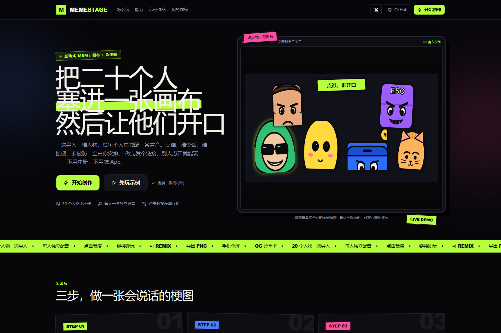
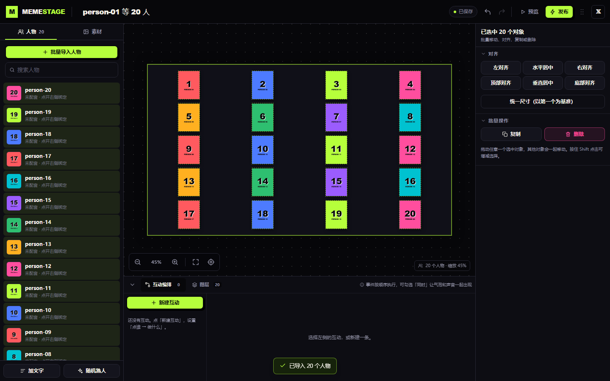
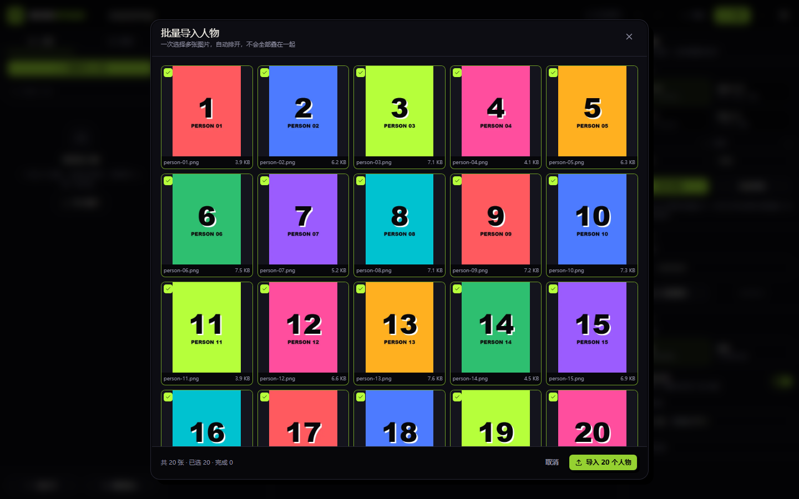
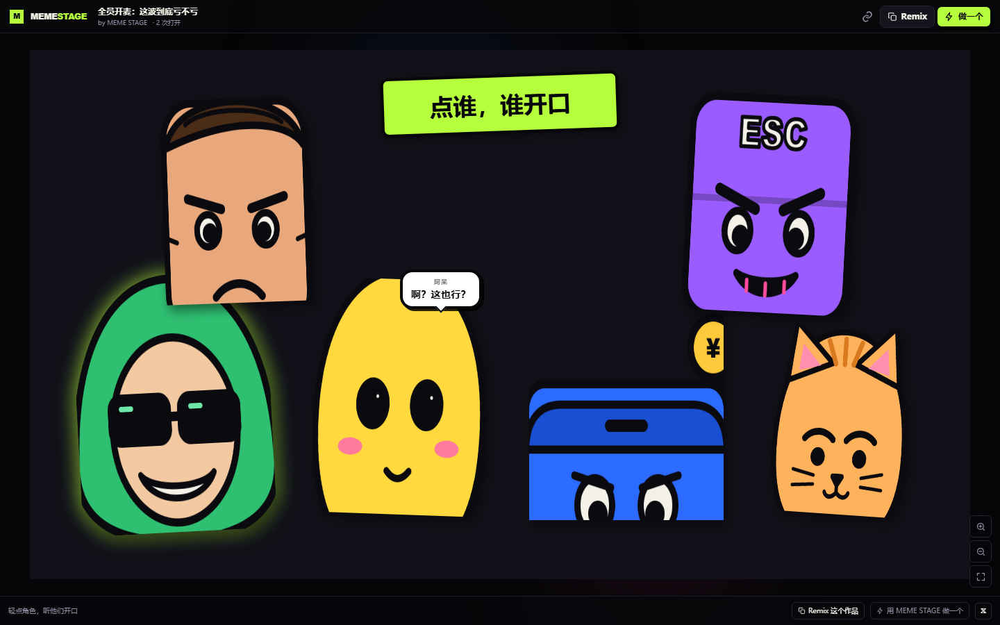
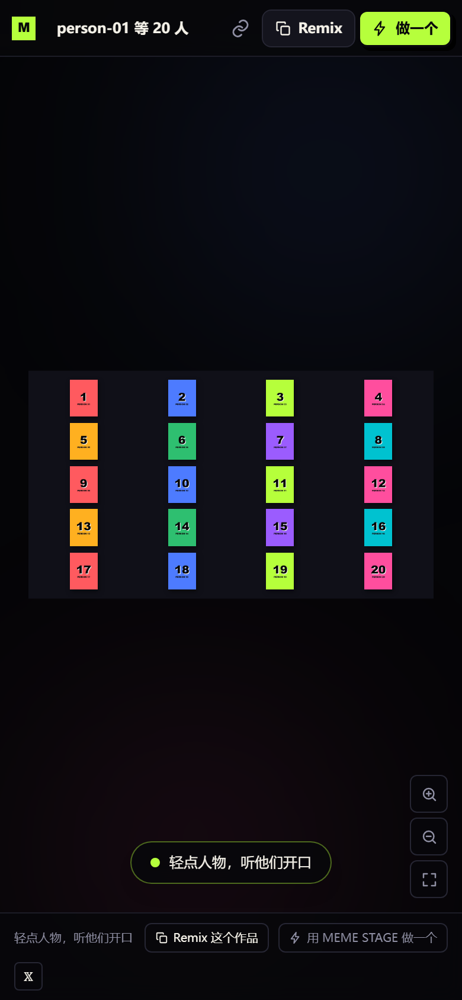
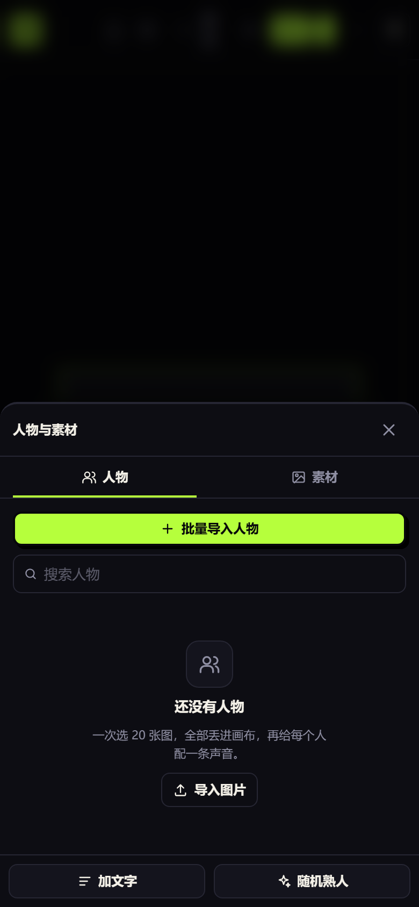

# MEME STAGE

> 把二十个人塞进一张画布，然后让他们开口。
> An infinite meme canvas where every character has a voice, a line, and an opinion.

[**▶ 打开线上版本**](https://meme-stage.pages.dev) · [**🎭 先玩官方示例**](https://meme-stage.pages.dev/p/demo) · [**𝕏 @0xkillcoin**](https://x.com/0xkillcoin)


---

## 这是什么

**MEME STAGE** 不是图片编辑器，也不是在线白板。

它把「贴纸拼贴」和「语音互动」揉在一起：一次导入几十个人物，给每个人绑一条独立语音和台词，编排「点谁 → 谁说话 → 谁接梗」的互动链，最后发布成一个**打开就能点、点了就有声音**的网页作品。

- 不需要注册，不需要写代码。
- 桌面端负责创作，手机端负责浏览和玩。
- 发布后就是一个链接，丢进 X、微信群、Telegram 都能打开。

官方示例（真实发布）：**https://meme-stage.pages.dev/p/demo**

---

## 截图

| 首页 · 可直接点人物试听 | 创作工作台 · 20 人物 |
| --- | --- |
|  |  |

| 批量导入 · 自动布局 | 发布后的访客页面 |
| --- | --- |
|  |  |

| 手机端作品页 | 手机端编辑器 |
| --- | --- |
|  |  |

---

## 已实现的功能

### 无限画布

- 平移（拖空白 / 空格拖 / 中键拖）、滚轮与触控板缩放、双指捏合缩放。
- 单击选择、Shift 多选、框选、多选整体拖动。
- 拖拽移动、8 向缩放、旋转、精确数值输入、透明度、翻转、锁定、隐藏。
- 吸附对齐 + 实时参考线（可关闭），Alt 临时关闭吸附。
- 图层面板、置顶 / 置底 / 上移 / 下移，稳定 ID 与连续 z 序。
- 撤销 / 重做（60 步，拖拽和滑杆会合并历史，不会产生几百条碎片记录）。
- 快捷键：`⌘/Ctrl+Z`、`⇧⌘Z`、`⌘D`、`⌘C/V`、方向键微调、`⌘0` 适应画布、`Delete`、`Esc`。
- 一键适应内容、一键定位选中、缩放比例显示、世界坐标与屏幕缩放在数据层完全分离。
- 画幅预设 16:9 / 9:16 / 1:1 / 4:5 + 自定义宽高 + 自由画布模式。

### 多人物批量导入

- 多选文件、拖拽文件、逐张追加，一次最多 300 个元素。
- 导入前在浏览器内压缩（长边 1500px WebP + 420px 缩略图），原图比例不变。
- 批量面板显示缩略图、文件名、实际尺寸、文件大小、上传状态与失败原因，可单张移除、全选/取消。
- 6 种自动布局：自由散落、网格、中心聚集、随机拼贴、避免重叠、自定义（列数 / 间距 / 人物高度 / 重叠度），带实时布局预览。
- 20 张图导入后 20 个坐标互不重复，且全部落在画幅内；50 张图实测同样通过（50 元素 / 50 唯一坐标 / 全部在画幅内）。导入后每个实例仍可独立拖动、缩放、旋转、配音。
- 同一张图片可以多次复用，每个实例拥有独立 ID、位置和互动配置。

### 声音与文字

- 每个人物可绑定独立语音，支持 MP3 / WAV / M4A / OGG（服务端按文件头识别真实格式）。
- 试听、替换、删除、从素材库重新绑定、独立音量。
- 台词输入 + 6 种气泡预设（漫画 / 纯色 / 思考 / 字幕 / 大字 / 自定义）。
- 气泡可调底色、文字色、描边色、描边宽度、圆角、内边距、字号、粗体、斜体、尾巴方向、出现动画、停留时长。
- 单音频模式（新声音打断旧声音）/ 混音模式，可在作品设置里切换。
- 音频加载失败、浏览器拦截自动播放、没有绑定语音，都会给出明确提示，不会静默失败。

### 互动编排

- 可视化事件列表：**触发（点谁）→ 动作 → 下一个事件**。
- 9 种动作：播放语音、说一句话、播放动画（弹跳/抖动/弹出/旋转/脉冲）、显示、隐藏、移动、等待、全屏闪白、跳转事件。
- 每个动作可单独勾选「同时」，让气泡和声音一起出现，也可以严格按顺序执行。
- 事件可自动接续（next），也支持 goto；带循环检测和最大深度保护。
- 在编辑器里点「测试」会直接进入真实的访客运行时，不是另一套假逻辑。

### 保存、发布与分享

- 自动保存：停止输入 1.4s 后写入云端；本地草稿同步写入 localStorage，断网也不丢。
- 真实保存状态：`保存中… / 已保存 / 保存失败 / 未保存 / 本地草稿`，失败时保留本地并提供重试。
- 冲突处理：重载或双窗口造成的版本竞争会先重新读取 rev 再保存，必要时用本地可见版本覆盖；仍失败才提示冲突。
- 发布生成稳定链接 `/p/:slug`，访客无需注册。
- 发布时自动用当前画布生成 1200×630 分享封面，写入 R2，并注入 Open Graph / Twitter Card meta（X、微信、Telegram、iMessage 都有预览图）。
- 分享：复制链接、系统分享、X intent、二维码可以自行用链接生成。
- 导出 PNG（当前画幅，1.5× 分辨率）和项目 JSON；可 Remix 别人的公开作品。
- 官方示例 `/p/demo` 为真实发布作品，不是静态演示页。

### 移动端

- 作品页：全屏画布、双指缩放、单指平移、点击人物播放声音、气泡浮层、无横向溢出。
- 编辑器：底部工具栏 + 底部抽屉（人物 / 属性 / 互动），画布始终可见，不被面板完全遮住。
- 页面适配安全区、`100dvh`、`prefers-reduced-motion`。

---

## 快速开始

需要 **Node.js 22+**（本项目在 Node 24 + npm 11 上开发）。

```bash
# 1. 安装
npm install

# 2. 本地前端（API 需要 Pages Functions，见下一节）
npm run dev            # http://localhost:5173

# 3. 构建 + 类型检查
npm run build

# 4. 单元测试
npm test
```

> 本地只跑 `vite` 时，编辑器可以打开，但上传/云保存/发布会因为 `/api` 不存在而失败。完整功能请用 Pages 环境（下方部署步骤）或直接使用线上版本。

### 本地/线上一键部署

```bash
# 首次：创建 D1 并建表
npx wrangler d1 execute meme-stage-db --remote --file=./db/schema.sql

# 构建并发布到 Cloudflare Pages
npm run deploy
```

`wrangler.jsonc` 已经声明了 `DB`（D1）和 `BUCKET`（R2）绑定，只需把 `database_id` 和 `bucket_name` 换成你自己的。

### 环境变量

运行时**不需要任何密钥**。浏览器与同源的 Pages Functions 通信，身份是浏览器本地生成的 256-bit capability key。

只有部署和种子脚本会用到环境变量，见 [`.env.example`](.env.example)：

| 变量 | 用途 |
| --- | --- |
| `CLOUDFLARE_API_TOKEN` | 部署 Pages / 操作 D1 / R2 |
| `CLOUDFLARE_ACCOUNT_ID` | Cloudflare 账户 |
| `D1_DATABASE_ID` | `wrangler.jsonc` 中的 D1 id |
| `R2_BUCKET_NAME` | 素材桶 |
| `SEED_EDITOR_KEY` | 可选，官方示例的归属 key |

> 真实的 token、密钥、R2 凭据**没有**写进仓库，也不应该写进来。

---

## 技术架构

```text
Browser (React 19 + TypeScript + Vite + Tailwind CSS v4)
│
├── Konva canvas
│   ├── EditorCanvas  ── 平移/缩放/框选/吸附/Transformer/导出
│   └── VisitorStage  ── 同一套元素渲染 + DOM 气泡 + 交互运行时
│
├── Zustand store      ── 项目文档、历史、选区、视口、保存状态
├── InteractionRunner  ── 顺序/并行动作、事件链、取消、循环保护
├── AudioEngine        ── 单音频/混音、播放失败提示、手势解锁
└── IndexedDB/localStorage 草稿（离线兜底）
│
└── fetch /api/*  (same origin)
        │
Cloudflare Pages + Pages Functions
├── D1   projects / assets
├── R2   meme-stage/{assets,cover}/*
└── /p/:slug  读取 D1 → 注入 OG meta → 返回 SPA
```

**技术选型理由**

- **Konva**：需要真正的场景图、变换矩阵、命中检测和导出，DOM 堆图在 50 个人物时会崩。选中框、Transformer、参考线都能直接复用。
- **云函数 + D1 + R2**：保存/发布需要服务端权威数据和文件存储；D1 单文档模型足够 MVP，且免费额度友好。
- **不带任何 UI 组件库**：整站设计语言（荧光绿、硬阴影、贴纸、粗描边）需要从零控制，避免通用后台味。
- **匿名 capability 身份**：不引入 OAuth/邮箱验证的摩擦，同时保证私有作品不能被别的 key 修改。

### 数据模型

`projects`

| 字段 | 说明 |
| --- | --- |
| `id` | UUID |
| `slug` | 发布后的短链，唯一 |
| `owner_hash` | SHA-256(editor key)，不存明文 |
| `data` | 版本化 JSON（ProjectData v1） |
| `cover_url` | 分享封面 |
| `visibility` / `published` | 访问控制 |
| `rev` | 乐观并发版本 |
| `views` | 打开次数 |
| `created_at` / `updated_at` | 时间戳 |

`assets`

| 字段 | 说明 |
| --- | --- |
| `id` | UUID |
| `owner_hash` | 归属 |
| `kind` | image / audio / cover |
| `object_key` | R2 key |
| `mime` / `size` / `name` | 真实嗅探结果与元数据 |
| `width` / `height` / `duration` | 展示用 |

作品 JSON 结构（`src/lib/types.ts`）：

```ts
ProjectData {
  version: 1
  title, description, mode, width, height
  background { type, color, url? }
  elements: CanvasElement[]   // character | text | image，稳定 ID + z 序
  events:   EventDef[]        // 触发 → steps[] → nextEventId
  settings: { audioMode, reactions, showAuthor, allowRemix, ... }
  updatedAt
}
```

所有元素引用使用稳定 ID（而不是数组下标），服务端会做完整校验、去重、数量上限、URL 白名单和颜色白名单。

### API

| 方法 | 路径 | 说明 |
| --- | --- | --- |
| `POST` | `/api/projects` | 创建私有作品 |
| `GET` | `/api/projects` | 当前 key 的作品列表 |
| `GET` | `/api/projects/:id` | 读取自己的作品 |
| `PUT` | `/api/projects/:id` | 保存（rev 乐观锁 + 幂等重试） |
| `DELETE` | `/api/projects/:id` | 删除 |
| `POST` | `/api/projects/:id/publish` | 发布 / 更新发布，生成封面与 slug |
| `DELETE` | `/api/projects/:id/publish` | 取消发布 |
| `GET` | `/api/public/:slug` | 公开作品 |
| `POST` | `/api/public/:slug/view` | 打开计数（限流） |
| `POST` | `/api/assets` | 上传图片/音频/封面（multipart） |
| `GET` | `/api/assets` | 素材库 |
| `DELETE` | `/api/assets/:id` | 删除素材 |
| `GET` | `/api/files/:id` | 文件流（支持 Range，Immutable 缓存） |

私有接口统一要求 `X-Editor-Key`；跨站写请求会被 middleware 拒绝。

---

## 测试

### 单元测试（30 个，全部通过）

```bash
npm test
```

覆盖：

- 6 种自动布局的边界、去重、确定性、比例保持、画幅内约束。
- 项目 schema：重复 ID、非法类型、越界数值、`javascript:` / `//evil` URL、颜色注入、事件引用、序列化。
- 交互运行时：默认反应、顺序执行、并行、事件链、循环保护、缺失语音、快速点击取消。
- 视口几何：适配、围绕指针缩放、吸附、旋转内容包围盒。

### 端到端（真实 Cloudflare Pages 生产环境）

```bash
npm run test:e2e       # Playwright: 桌面 + 手机（Pixel 7 视口）公共页面
```

`npm run test:e2e` 在 2026-10-27 的结果：**12 / 12 通过**（桌面 Chrome、Pixel 7 视口、iPhone 13 Safari/WebKit × 首页 / 示例语音 / 发布页 / 404）。

完整创作闭环用下面的脚本复跑：

```bash
node scripts/test-editor.mjs https://meme-stage.pages.dev
node scripts/test-features.mjs https://meme-stage.pages.dev
node scripts/verify-production.mjs https://meme-stage.pages.dev
```

2026-10-27 的实际结果：

| 验证项 | 结果 |
| --- | --- |
| 一次性导入 20 张图片 | ✅ 20 个元素 / 20 个唯一坐标 |
| 一次性导入 50 张图片 | ✅ 50 个元素 / 50 个唯一坐标 / 全部在画幅内，拖动正常（37s，100 次上传） |
| 人物独立拖动 + 撤销 | ✅ 坐标变化后 `⌘Z` 精确还原 |
| 滚轮缩放 | ✅ 140% → 226% |
| 绑定语音 + 台词 | ✅ 上传 R2，回读 URL 正确 |
| 新建互动事件 | ✅ 触发者、动作、下一事件写入作品 JSON |
| 发布 + 分享链接 | ✅ `/p/person-01-20-…` 可访问，封面写入 R2 |
| 手机打开分享链接 | ✅ 390×844，无横向溢出 |
| iPhone 13 Safari（WebKit） | ✅ 全部页面无横向溢出，点击出气泡、音频触发 |
| 手机点击人物 | ✅ 气泡出现，音频真实触发 |
| 多选批量移动 | ✅ 两个人物同位移 (55, 27) |
| 锁定后拖动 | ✅ 位置不变 |
| 图层置顶 | ✅ z 值最大 |
| PNG 导出 | ✅ 约 215 KB 真实图片 |
| 编辑器预览 | ✅ 与发布页同一套运行时，声音触发 |
| 保存后刷新 | ✅ 元素、位置、URL 全部恢复 |
| 手机端编辑器 | ✅ 无横向溢出，底部抽屉可用 |
| 未授权读取私有作品 | ✅ 404 |
| 伪造 PNG 上传 | ✅ 415（文件头嗅探） |
| 路径穿越 / 非法文件 ID | ✅ 404 |
| 断网自动保存 | ✅ 显示「保存失败」，本地草稿保留 2 个文字元素；恢复网络后自动「已保存」 |
| 音频加载失败 | ✅ 明确提示「老K · 这波不亏」播放失败，不会卡住互动 |
| 上传不支持的文件 | ✅ 明确提示，导入弹窗保持打开 |
| 控制台错误 | ✅ 最终回归 0 个 |

> 注：本机 Windows 环境的 `workerd` 无法启动（本地 D1/Pages dev 崩溃），因此端到端测试直接跑在 Cloudflare Pages 生产环境，构建与函数打包由 wrangler 完成。
> 演示语音由 Windows SAPI 合成（算力来自本机），人物 SVG/PNG 为本项目原创。

---

## 部署到 Cloudflare Pages

1. 新建 D1：`wrangler d1 create meme-stage-db`，把 `database_id` 填入 `wrangler.jsonc`。
2. 建表：`wrangler d1 execute meme-stage-db --remote --file=./db/schema.sql`。
3. 准备 R2 bucket，把名称填入 `wrangler.jsonc` 的 `r2_buckets`。
4. `wrangler pages project create meme-stage --production-branch=main`（首次）。
5. `npm run deploy`。
6. 可选：`node scripts/seed-demo.mjs https://你的域名` 发布官方示例（会在 `.seed/seed.json` 生成归属 key，已被 gitignore）。

Pages Functions 的 `/_redirects` 已处理 `/editor/*`、`/library` 的 SPA 回退；`/p/:slug` 由 Function 注入 OG meta。

### 为什么不是 GitHub Pages？

GitHub Pages 只能托管纯静态文件，无法运行 Pages Functions、D1 和 R2。本项目的「保存 / 发布 / 上传 / 私有访问控制 / 动态 OG 注入」都需要服务端，所以线上版本放在 Cloudflare Pages。GitHub 仓库仍然作为源码主站和 Issue 入口。

如果你要迁移到 Vercel，需要把 `functions/` 改写为 Vercel Functions，并把 D1 换成 Postgres、R2 换成 S3 兼容存储；前端代码和项目 JSON 格式可以直接复用。

---

## 免费额度与成本

当前实现只使用 Cloudflare 的免费层能力，没有开通付费项。**额度可能调整，请以 Cloudflare 官方页面为准**：

| 资源 | 免费额度（大致） | 本项目的控制方式 |
| --- | --- | --- |
| Pages Functions | 10 万请求/天 | 静态资源走 CDN；API 仅在保存/发布/上传时调用 |
| D1 | 5 GB 存储、500 万行读/天、10 万行写/天 | 1.4s 防抖保存；单作品 JSON ≤ 2 MB；300 元素上限 |
| R2 | 10 GB 存储、100 万 Class A/月、1000 万 Class B/月 | 图片先压缩；缩略图独立；单文件 8/12 MB 上限 |

**成本提示**：如果作品量或访问量明显增长，D1 行写入和 R2 存储会先触顶。扩展方向：作品 JSON 压到 R2、D1 只存索引；或迁移到 Durable Objects / 自建 Postgres。

演示素材（人物 PNG、语音 WAV）放在 Pages 静态资源里，不占 R2。

---

## 安全与隐私

- **文件校验**：服务端按 magic bytes 判断真实类型，只接受 JPG/PNG/WebP/GIF/AVIF/MP3/WAV/OGG/M4A；不信任客户端的 `Content-Type` 与扩展名。
- **大小限制**：图片 8 MB、音频 12 MB、封面 2 MB、作品 JSON 2 MB；单 key 素材 600 个。
- **访问控制**：编辑器 key 只在浏览器生成，服务端只保存 SHA-256；私有作品按 `owner_hash` 隔离，公开作品只能通过已发布的 slug 读取。
- **注入防护**：项目 JSON 全字段白名单校验；URL 只允许同源相对路径；颜色只允许 hex/rgb(a)；React 默认转义；画布文字走 Canvas 文本而非 HTML。
- **CSP**：`script-src 'self'`、`object-src 'none'`、`frame-ancestors 'self'`；上传文件响应额外加 `nosniff` 与 `sandbox` CSP。
- **跨站写保护**：`/api/*` 非 GET 请求校验 `Origin`。
- **限流**：上传、创建、阅读计数均按 IP 做 best-effort 限流；D1/R2 配额是最终兜底。
- **隐私**：不接入第三方统计、不写 cookie、不发行为日志；作品内容只存在 D1/R2 和你自己的浏览器。

**已知的安全边界**：匿名 key 模式不提供账号找回；清除浏览器数据会失去作品编辑权。这是刻意的取舍，已在限制中说明。

---

## 已知限制

- **不做 AI 抠图**。建议上传透明背景 PNG；普通照片会保留原背景。
- **没有账号系统**。所有权绑定当前浏览器生成的 key；换设备/清缓存无法编辑旧作品。
- **社交平台只显示静态封面**。X/微信里的链接卡片是图片 + 标题，真正互动要点进链接。
- **多人协作未实现**。同一作品多窗口编辑采用「最后可见版本优先」，不做实时合并。
- **手机端编辑器是可用级别**，复杂排版仍建议桌面端；作品浏览和互动在手机上是完整体验。
- **音频格式依赖浏览器**。服务端会校验，但个别浏览器对某些编码的支持仍可能失败，会有明确错误提示。
- **无自动化清理任务**。删除作品不会级联删除历史素材，避免误删被其他作品引用的文件。

---

## Roadmap

- [ ] 语音转字幕 / 逐字动画
- [ ] 人物分组、批量绑音、批量改色
- [ ] 作品社区与精选（需要审核与举报）
- [ ] 自定义域名 / 短链
- [ ] AI 抠图（可选、可关闭、需要额外配置）
- [ ] 移动端手势编辑器增强（旋转手柄、双指缩放元素）

---

## 贡献

Issue 和 PR 都欢迎。请先运行：

```bash
npm run build && npm test
```

涉及数据的改动请同步更新 `src/lib/schema.ts`、`tests/unit/schema.test.ts` 和 README 的数据模型部分。

---

## English

**MEME STAGE** is an infinite-canvas studio for interactive memes. Import dozens of characters at once, give each one its own voice clip and line, wire up click-driven dialogue chains, and publish a single link that anyone can open and play — no sign-up, no code.

**Live:** https://meme-stage.pages.dev · **Demo:** https://meme-stage.pages.dev/p/demo · **Author:** [@0xkillcoin](https://x.com/0xkillcoin)

### Highlights

- True infinite canvas: pan, wheel/pinch zoom, marquee + shift multi-select, group drag, rotate/resize, snapping guides, layers, 60-step undo/redo, keyboard shortcuts.
- Batch import of up to 300 images with client-side WebP compression and six auto-layout modes (no stacking).
- Per-character voice (MP3/WAV/M4A/OGG), subtitles, six bubble presets, fully styleable.
- Visual interaction editor: trigger → ordered/parallel actions → next event, with loop protection. The preview runs the exact same engine as the published page.
- Autosave with real status, offline drafts, optimistic revisions, conflict recovery.
- Publish to `/p/:slug` with an auto-generated 1200×630 Open Graph cover; PNG and JSON export; remix.
- Cloudflare Pages Functions + D1 + R2, free-tier friendly.

### Quick start

```bash
npm install
npm test           # 30 unit tests
npm run build
npx wrangler d1 execute meme-stage-db --remote --file=./db/schema.sql
npm run deploy
```

Set your own `database_id` / R2 bucket in `wrangler.jsonc`. Runtime needs no secrets: identity is a browser-generated capability key, only its SHA-256 is stored.

### Known limitations

No AI background removal (bring transparent PNGs), no account recovery (ownership is device-scoped), social previews are static images, and the mobile editor is functional but desktop remains the primary canvas.

### License

MIT © 2026 MEME STAGE
